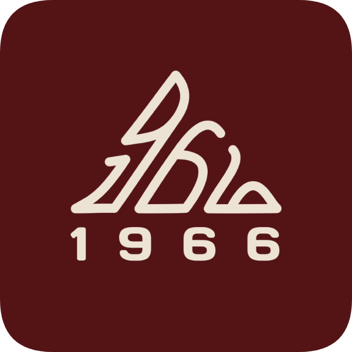

<p align="center">
  
</p>

<h1 align="center">1966 Caffe — Point of Sale (POS) & Operational System</h1>

<p align="center">
  Sistem Point of Sale (Kasir) dan Manajemen Operasional F&B modern dengan arsitektur <strong>100% Offline-First</strong>. Dirancang khusus untuk efisiensi transaksi, manajemen shift & kehadiran, pencatatan pengeluaran, serta rekapitulasi omset harian kedai kopi & restoran <strong>1966 Caffe</strong>.
</p>

<p align="center">
  <a href="https://github.com/SyafiqSiregar/1966-POS-System"></a>
  <a href="https://vite.dev/"></a>
  
  
  <a href="https://vercel.com/"></a>
  
</p>

---

## 📋 Daftar Isi
- [Gambaran Umum](#-gambaran-umum)
- [Fitur Utama](#-fitur-utama)
- [Kredensial Akun Awal](#-kredensial-akun-awal)
- [Teknologi yang Digunakan](#-teknologi-yang-digunakan)
- [Struktur Direktori](#-struktur-direktori)
- [Panduan Instalasi & Menjalankan](#-panduan-instalasi--menjalankan)
- [Panduan Deploy ke Vercel](#-panduan-deploy-ke-vercel)
- [Dukungan Printer Thermal Bluetooth](#-dukungan-printer-thermal-bluetooth)
- [Lisensi & Hak Cipta](#-lisensi--hak-cipta)

---

## ☕ Gambaran Umum

**1966 Caffe POS System** menghadirkan pengalaman kasir digital yang responsif, andal, dan ramah layar sentuh (*touchscreen-friendly*). Dibangun menggunakan web stack standar tanpa dependensi server yang rumit, aplikasi dapat beroperasi penuh tanpa koneksi internet (*offline mode*), menjaga kerahasiaan data internal, serta bebas dari risiko *downtime* akibat kendala jaringan.

Aplikasi juga mendukung evaluasi langsung via browser (*Progressive Web App*), pencetakan struk nota transaksi via Bluetooth thermal printer (ESC/POS), dan ekspor laporan omset serta absensi karyawan dalam format **PDF eksekutif** dan **Excel (.xls)** yang tertata rapi.

---

## ✨ Fitur Utama

### 1. Kasir POS Khusus F&B (Minuman & Makanan)
- **Katalog Terpisah**: Filter cepat untuk *Minuman & Kopi* (Espresso, Milk Based, Manual Brew, Non-Coffee) dan *Makanan & Snack* (Rice Bowl, Pasta, Pastry, Cemilan).
- **Tipe Pesanan**: Pilihan *Dine In* (dengan nomor meja), *Takeaway* (nama pelanggan), dan *Delivery* (catatan ojol/ekspedisi).
- **Keranjang Belanja Cepat**: Penyesuaian kuantitas instan, catatan pesanan khusus per item, serta kalkulasi otomatis subtotal, diskon (persen / nominal), dan pajak restoran (PB1).
- **Multi-Metode Pembayaran**: Tunai (kalkulator kembalian otomatis & tombol nominal pas), QRIS, dan Transfer Bank.

### 2. Ekspor Laporan Omset Eksekutif (PDF & Excel)
- **Dokumen PDF Resmi**: Berformat **A4 Landscape** dengan identitas visual 1966 Caffe (Burgundy `#4B151E`), 4 kartu ringkasan KPI (*Total Omset, Total Transaksi/AOV, Omset Minuman, Omset Makanan*), tabel pesanan terperinci, nomor halaman, dan blok tanda tangan validasi kasir & manajer.
- **Spreadsheet Excel (.xls)**: XML/HTML spreadsheet berstandar UTF-8 BOM lengkap dengan kartu KPI di bagian atas, tabel zebra selang-seling yang rapi, dan format angka mata uang otomatis.

### 3. Presensi & Audit Kehadiran Karyawan
- **Clock-In & Clock-Out Mandiri**: Pencatatan waktu masuk dan pulang kerja kasir/staf dengan proteksi PIN.
- **Jadwal Shift Fleksibel**: Pengaturan jadwal shift (pagi/sore/malam) dengan toleransi keterlambatan (*grace period*) yang dapat dikonfigurasi oleh Administrator.
- **Ekspor Laporan Kehadiran**: Rekapitulasi presensi karyawan siap cetak/ekspor dalam format PDF Landscape dan Excel.

### 4. Pembukuan Biaya Operasional & Kas Kecil (Petty Cash)
- Pencatatan pengeluaran operasional toko (belanja biji kopi, susu, cup/packaging, listrik, perlengkapan).
- Pelacakan sumber dana: Kas Toko vs Uang Talangan Karyawan pribadi.
- Manajemen status penggantian dana (*Reimbursement*) agar pembukuan kasir seimbang pada akhir shift.

### 5. Dasbor Finansial & Analitik Real-Time
- Pemantauan metrik finansial harian: Total Omset Kotor, Pengeluaran, dan Estimasi Laba Bersih.
- Komparasi pendapatan kategori: *Minuman & Kopi* vs *Makanan & Snack*.
- Peringkat 5 Menu Terlaris (*Top 5 Best Seller*) berdasarkan kuantitas dan nominal penjualan.

### 6. Kontrol Akses Berbasis Peran (RBAC)
- **Administrator**: Memiliki hak akses menyeluruh (Dasbor Keuangan, Kelola Master Menu, Riwayat Transaksi, Biaya Operasional, Manajemen Anggota/PIN, Rekap Kehadiran, dan Pengaturan Sistem).
- **Kasir / Staf**: Antarmuka fokus khusus untuk pemrosesan order POS, cetak nota, presensi shift, dan pencatatan biaya kasir.

---

## 🔑 Kredensial Akun Awal

Sistem menyertakan akun bawaan untuk pengujian awal:

| Peran (Role) | Username | PIN Akses | Hak Akses Utama |
| :--- | :--- | :--- | :--- |
| **Administrator** | `admin` | `1966` | Akses penuh ke seluruh menu & konfigurasi data |
| **Kasir** | `kasir` | `1966` | Transaksi kasir, cetak nota, dan input biaya harian |

> *Catatan Keamanan*: Nama staf, peran, dan PIN dapat diubah kapan saja melalui menu **Manajemen Anggota** oleh akun Administrator.

---

## 🛠️ Teknologi yang Digunakan

- **Core**: HTML5 Semantic, Modern Vanilla CSS3, JavaScript ES6+ (Modular).
- **Build Tool**: [Vite 8](https://vite.dev/) — kompilasi cepat dengan Hot Module Replacement (HMR).
- **Desain & Ikon**: Curated Typography, Burgundy Brand System `#4B151E`, dan [Lucide Icons](https://lucide.dev/).
- **Engine Cetak Thermal**: Web Bluetooth API dengan ESC/POS Command Byte Encoder (`thermal-printer.js`).
- **Dokumen Generator**: [jsPDF](https://github.com/parallax/jsPDF) & [jsPDF-AutoTable](https://github.com/simonbengtsson/jsPDF-AutoTable).
- **Penyimpanan Data**: `localStorage` terstruktur dengan skema JSON mandiri (dukungan opsional konektor Supabase client).

---

## 📁 Struktur Direktori

```text
1966-POS-System/
├── .env.example              # Template variabel lingkungan untuk konfigurasi opsional
├── .gitignore                # Aturan pencegahan commit berkas rahasia & cache
├── README.md                 # Dokumentasi utama proyek
├── docs/                     # Dokumentasi arsitektur dan spesifikasi teknis
│   ├── arsitektur.md         # Diagram dan alur sistem
│   ├── desain.md             # Panduan identitas visual & warna
│   ├── fitur_detail.md       # Logika bisnis dan rumus kalkulasi
│   └── ui.md                 # Spesifikasi antarmuka layar
├── index.html                # Entry point aplikasi web (Single Page Application)
├── local-file-saver.js       # Modul pengunduhan berkas lokal perangkat (Blob Web API)
├── logo-data.js              # Enkoding Base64 logo resmi 1966 Caffe
├── main.js                   # Logika sentral aplikasi, state, cart, & interaksi UI
├── package.json              # Konfigurasi dependensi dan skrip proyek
├── package-lock.json         # Kunci versi dependensi npm
├── public/                   # Aset publik statis (favicon, logo, ikon SVG)
│   ├── 1966-logo-badge.png   # Logo badge utama 1966 Caffe
│   ├── 1966-logo-black.png   # Logo monochrome hitam
│   ├── 1966-logo-white.png   # Logo monochrome putih
│   ├── favicon.svg           # Favicon browser
│   └── icons.svg             # Kumpulan ikon SVG
├── src/                      # Modul integrasi pendukung
│   ├── api.js                # Abstraksi sinkronisasi data
│   └── supabaseClient.js     # Klien Supabase (aman dengan environment variables)
├── style.css                 # Sistem desain visual, tema responsif, dan animasi
├── supabase/                 # Berkas skema basis data
│   └── schema.sql            # Definisi tabel DDL Supabase / PostgreSQL
├── thermal-printer.js        # Driver printer thermal Bluetooth ESC/POS
└── vercel.json               # Konfigurasi rewrite SPA untuk hosting Vercel
```

---

## 🚀 Panduan Instalasi & Menjalankan

### Prasyarat
- **Node.js**: Versi 18.0.0 atau yang lebih baru.
- **NPM**: Versi 9.0.0 atau yang lebih baru.

### Langkah Menjalankan di Komputer Lokal
1. **Clone repositori**:
   ```bash
   git clone https://github.com/SyafiqSiregar/1966-POS-System.git
   cd 1966-POS-System
   ```

2. **Pasang dependensi**:
   ```bash
   npm install
   ```

3. **Jalankan server pengembangan**:
   ```bash
   npm run dev
   ```
   Aplikasi akan aktif di alamat lokal: `http://localhost:5173/`.

4. **Kompilasi paket produksi**:
   ```bash
   npm run build
   ```

---

## ☁️ Panduan Deploy ke Vercel

Aplikasi ini sudah dilengkapi dengan berkas [`vercel.json`](vercel.json) sehingga dapat langsung di-deploy secara instan dan gratis:

1. Buka [https://vercel.com/new](https://vercel.com/new) dan masuk dengan akun GitHub Anda.
2. Cari dan pilih repositori **`1966-POS-System`**, lalu klik **Import**.
3. Vercel akan secara otomatis mendeteksi konfigurasi Vite:
   - **Framework Preset**: `Vite`
   - **Build Command**: `npm run build`
   - **Output Directory**: `dist`
4. Klik **Deploy**. Dalam 1 menit, aplikasi aktif pada domain HTTPS (contoh: `https://1966-pos-system.vercel.app`).
5. **Mode PWA (Install di HP / Tablet)**: Buka tautan Vercel tersebut di browser Chrome (Android) atau Safari (iOS), lalu pilih opsi **"Add to Home Screen"** agar aplikasi dapat dibuka dalam mode layar penuh layaknya aplikasi native.

---

## 🖨️ Dukungan Printer Thermal Bluetooth

Aplikasi mendukung komunikasi langsung dengan printer thermal mini via **Web Bluetooth API**:
- **Ukuran Kertas**: 58mm dan 80mm.
- **Protokol**: Standar ESC/POS.
- **Kompatibilitas**: Peramban Google Chrome pada Android, tablet, dan PC/Laptop dengan Bluetooth aktif.
- **Format Struk**: Header logo 1966 Caffe, tanggal & jam transaksi, nomor meja / referensi, detail kuantitas & harga menu, rincian pembayaran, serta footer ucapan terima kasih.

---

## 📄 Lisensi & Hak Cipta

© 2026 **1966 Caffe** (Specialty Coffee & Eatery).  
Hak Cipta dilindungi undang-undang. Dikembangkan untuk efisiensi operasional POS mandiri.
